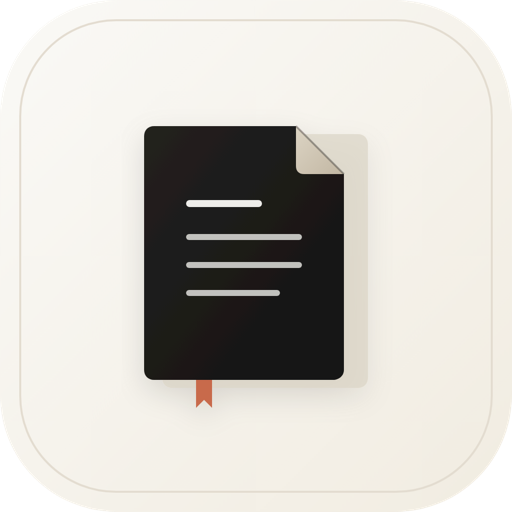

<div align="center">



# Notebook

<p><strong>A canvas with no edges.</strong></p>

<p>An infinite-canvas notebook for thinking, writing and collecting.<br />
Import documents, scatter ideas across a dot grid, draw the lines between them —<br />
then keep everything on your own machine.</p>

<br />

<p>
  <a href="#-setup"></a>
  <a href="https://v2.tauri.app"></a>
  <a href="https://react.dev"></a>
  <a href="https://www.typescriptlang.org"></a>
  <a href="https://vite.dev"></a>
  <a href="https://tailwindcss.com"></a>
</p>

<p><sub>Node.js 20.19+ &nbsp;·&nbsp; Rust stable &nbsp;·&nbsp; Tauri 2</sub></p>

</div>

---

<div align="center">


<sub><em>PDFs, slides, notes and arrows — all on one endless surface.</em></sub>

</div>

---

## ✦ What it is

| | |
| :-- | :-- |
| **∞ Infinite canvas** | Pan, zoom and arrange anything on a quiet dot grid. No pages, no margins, no fixed order. |
| **📄 Documents become cards** | Drop in a PDF, Word file or PowerPoint deck. Every page is rasterised to a consistent size and becomes a movable object. |
| **🖋 Notes & arrows** | Rich-text notes with font, size, weight and colour controls. Curved arrows draw the connections between ideas. |
| **🗂 Notebooks & sections** | Keep work separated, search across it, multi-select, duplicate, copy and paste. Lock imported pages so they stay put. |
| **📤 Export** | Turn any section into a PDF in one click. |
| **🔒 Local-first** | Notebooks live in `~/Documents/Notebook`. No account, no sync, no cloud. |
| **🌗 Native feel** | Light and dark themes, native save dialogs, real keyboard shortcuts. |

> **The idea:** a notebook should behave like a desk, not a document. Spread things
> out, leave them there, come back later.

---

## ✦ The stack

```
Tauri 2  ·  React 19  ·  TypeScript  ·  Vite 8  ·  Tailwind v4
Zustand  ·  TipTap  ·  pdf.js  ·  docx-preview  ·  pptx-preview  ·  jsPDF
```

The Rust layer is deliberately thin — it registers Tauri plugins and nothing more.
Nearly everything is TypeScript in `src/`.

---

## ⚙ Setup

### Everyone needs

| Tool | Version | Why |
| :-- | :-- | :-- |
| [Node.js](https://nodejs.org) | **20.19+** | Vite and the Tauri CLI |
| [Rust](https://rustup.rs) | stable | Compiles the desktop shell |
| [Tauri CLI](https://v2.tauri.app) | v2 | Installed by `npm ci` — nothing to add |

Then, from the repository root:

```bash
npm ci
npm run doctor
```

`doctor` inspects the machine, ticks off what is installed, warns about the
optional cross-build tools, and tells you exactly what is missing. It is the
fastest way to find out why a build will not start.

---

### 🍎 macOS

**One-time prerequisites**

```bash
# 1. Apple's command-line toolchain
xcode-select --install

# 2. Rust
curl --proto '=https' --tlsv1.2 -sSf https://sh.rustup.rs | sh
source "$HOME/.cargo/env"
```

**Install and run**

```bash
git clone <this-repo> notebook && cd notebook
npm ci
npm run doctor
npm run tauri dev        # the real desktop app
```

**Build installers**

```bash
npm run build:macos                    # Apple silicon → .dmg + .app.zip
npm run build:macos -- --arch x86_64   # Intel Mac
npm run build:macos -- --arch universal
```

Universal builds need both Rust targets once:

```bash
rustup target add aarch64-apple-darwin x86_64-apple-darwin
```

> The generated `.dmg` opens with the icon on the left and **Applications** on the
> right — install by dragging one onto the other. The window art lives at
> `src-tauri/icons/dmg-background.png`.

macOS installers can only be built on macOS.

---

### 🪟 Windows

**One-time prerequisites**

1. **Visual Studio Build Tools** — install
   [VS Build Tools](https://visualstudio.microsoft.com/visual-cpp-build-tools/) and
   tick **Desktop development with C++** (this brings the MSVC linker and the
   Windows SDK).
2. **Rust** — download `rustup-init.exe` from [rustup.rs](https://rustup.rs) and run
   it. The default `stable-x86_64-pc-windows-msvc` toolchain is what you want.
3. **WebView2** — already present on Windows 11 and current Windows 10. If not,
   install the [Evergreen runtime](https://developer.microsoft.com/microsoft-edge/webview2/).
4. **Node.js 20.19+** — the LTS installer from [nodejs.org](https://nodejs.org).

**Install and run** (PowerShell)

```powershell
git clone <this-repo> notebook
cd notebook
npm ci
npm run doctor
npm run tauri dev
```

**Build the installer**

```powershell
npm run build:windows
```

Output: an NSIS `Notebook_<version>_x64-setup.exe` in `builds\windows\`. It installs
per-user, so no administrator prompt.

---

### 🐧 Linux

**One-time prerequisites — Debian / Ubuntu**

```bash
sudo apt update
sudo apt install -y build-essential curl wget file libssl-dev \
  libwebkit2gtk-4.1-dev libgtk-3-dev libayatana-appindicator3-dev \
  librsvg2-dev patchelf libxdo-dev dpkg-dev

# Rust
curl --proto '=https' --tlsv1.2 -sSf https://sh.rustup.rs | sh
source "$HOME/.cargo/env"
```

<details>
<summary><strong>Fedora</strong></summary>

```bash
sudo dnf install webkit2gtk4.1-devel gtk3-devel libappindicator-gtk3-devel \
  librsvg2-devel patchelf openssl-devel
```
</details>

<details>
<summary><strong>Arch / Manjaro</strong></summary>

```bash
sudo pacman -S --needed base-devel curl wget file openssl \
  webkit2gtk-4.1 gtk3 libappindicator-gtk3 librsvg patchelf
```
</details>

**Install and run**

```bash
git clone <this-repo> notebook && cd notebook
npm ci
npm run doctor
npm run tauri dev
```

**Build packages**

```bash
npm run build:linux
```

Output: a `.deb` and an `.AppImage` in `builds/linux/`. The AppImage is portable —
mark it executable and run it anywhere:

```bash
chmod +x builds/linux/*.AppImage
./builds/linux/*.AppImage
```

---

## 🏗 Build

One runner — `scripts/build.mjs` — detects the host, picks the right bundle
targets, compiles, and copies the artifacts into `builds/<platform>/` with a
fresh `SHA256SUMS.txt`.

```bash
npm run build:current   # installers for whatever OS you are on
```

| Command | Result | Runs on |
| :-- | :-- | :-- |
| `npm run build:macos` | `.dmg` + `.app.zip` | macOS |
| `npm run build:windows` | NSIS `-setup.exe` | Windows (or cross-compile) |
| `npm run build:linux` | `.deb` + `.AppImage` | Linux (or Docker) |
| `npm run build:all` | everything this host can produce | anywhere |
| `npm run build:web` | frontend bundle only (`dist/`) | anywhere |

### Options

```bash
npm run build:macos -- --arch universal   # aarch64 | x86_64 | universal (macOS only)
npm run build:linux -- --arch x86_64      # cross-arch bundle
npm run build:current -- --quality        # fat LTO: slower, smallest binary
npm run build:current -- --dry-run        # print the exact command, compile nothing
npm run build:current -- --bundles app,dmg
npm run build:current -- --ci --verbose
```

| Flag | Meaning |
| :-- | :-- |
| `--arch <arch>` | `aarch64`, `x86_64`, or `universal` (macOS only). Defaults to host. |
| `--bundles <list>` | Override the platform default bundle set. |
| `--quality` | Fat LTO + 1 codegen unit. Slower build, smallest binary. |
| `--ci` | Non-interactive mode, passed to the Tauri CLI. |
| `--dry-run` | Show what would run, then stop. |
| `-v, --verbose` | Verbose Tauri output. |

### Why builds are fast

- `Cargo.toml` uses **thin LTO + 16 codegen units** instead of fat LTO + 1 CGU.
  Rust compiles in parallel; `--quality` restores the slow, minimal-size profile.
- `tsc` runs incrementally and caches into `node_modules/.tmp`.
- Vite skips the gzip report pass, and the app background is a **378 KB WebP**
  (down from an 8.7 MB PNG), so the frontend payload is ~8 MB instead of ~17 MB.
- The entire Rust dependency tree compiles once. Later builds reuse
  `src-tauri/target/` and only rebuild what changed.

---

## 🔀 Cross-building

| Target | From macOS | From Linux | From Windows |
| :-- | :-- | :-- | :-- |
| **macOS** | native | ✗ | ✗ |
| **Windows** | ✅ cargo-xwin | ✅ cargo-xwin | native |
| **Linux** | ✅ Docker | native | ✗ |

**Windows from macOS or Linux** — one-time setup:

```bash
rustup target add x86_64-pc-windows-msvc
cargo install cargo-xwin

brew install llvm nsis          # macOS
sudo apt install llvm nsis      # Linux
```

Then:

```bash
npm run build:windows                       # x86_64 by default
npm run build:windows -- --arch aarch64     # Windows on ARM
```

**Linux from macOS** — Docker is the only requirement:

```bash
npm run build:linux                  # arm64 on Apple silicon
npm run build:linux -- --arch x86_64 # Intel/AMD
```

The runner pulls `rust:1.98-bookworm`, installs the webkit/GTK headers inside the
container, and keeps `node_modules`, the npm cache, the Cargo registry and the
Linux target directory in named volumes, so repeat builds are quick.

---

## 🔏 Signing a release

Local builds are unsigned — perfectly fine for yourself and for testing.

Set the environment variables before building when you distribute:

```bash
# macOS — Developer ID + notarisation
export APPLE_CERTIFICATE="$(base64 -i certificate.p12)"
export APPLE_CERTIFICATE_PASSWORD="••••••"
export APPLE_SIGNING_IDENTITY="Developer ID Application: Your Name (TEAMID)"
export APPLE_ID="you@example.com"
export APPLE_PASSWORD="app-specific-password"
export APPLE_TEAM_ID="TEAMID"

npm run build:macos
```

On Windows, point `bundle.windows` at your certificate thumbprint or a
`signCommand` (for example Azure Trusted Signing) in `src-tauri/tauri.conf.json`.
The full matrix is in the [Tauri distribution guide](https://v2.tauri.app/distribute/).

CI does the same thing without a local toolchain: `.github/workflows/build.yml`
builds all three platforms in parallel on a `v*` tag and uploads the installers
as workflow artifacts.

---

## 🖱 Using Notebook

1. Create a notebook, then add sections from the sidebar.
2. Press **Import** for a PDF / Word / PowerPoint file, or the paperclip for images.
3. Double-click empty canvas to write. Press **A** to draw arrows.
4. Export the current section from the toolbar's overflow menu.

### Keyboard

| Action | Shortcut |
| :-- | :-- |
| Command palette / search | <kbd>⌘</kbd> <kbd>K</kbd> |
| Toggle sidebar | <kbd>⌘</kbd> <kbd>B</kbd> |
| Back to notebooks | <kbd>⌘</kbd> <kbd>J</kbd> |
| Undo / redo | <kbd>⌘</kbd> <kbd>Z</kbd> / <kbd>⇧</kbd> <kbd>⌘</kbd> <kbd>Z</kbd> |
| Zoom in / out / reset | <kbd>⌘</kbd> <kbd>+</kbd> / <kbd>⌘</kbd> <kbd>−</kbd> / <kbd>⌘</kbd> <kbd>0</kbd> |
| Select · Hand · Arrow | <kbd>V</kbd> · <kbd>H</kbd> · <kbd>A</kbd> |
| New text note | <kbd>T</kbd> or double-click |
| Select all / duplicate | <kbd>⌘</kbd> <kbd>A</kbd> / <kbd>⌘</kbd> <kbd>D</kbd> |
| Delete selection | <kbd>⌫</kbd> |
| Pan | Space + drag, middle-drag, two-finger scroll |
| Zoom | <kbd>⌘</kbd> + scroll, or trackpad pinch |
| Flip an arrow's curve while drawing | <kbd>A</kbd> |

> On Windows and Linux, read <kbd>⌘</kbd> as <kbd>Ctrl</kbd>.

---

## 💾 Where your data lives

```
~/Documents/Notebook/
└── My notebook/
    ├── notebook.json      ← titles, elements, viewport, arrows
    └── images/            ← imported pages and pasted images
```

Disk is authoritative: on launch the app reads what is on disk and replaces the
cached state with it. A 350 ms debounce autosaves every change. Images are also
cached in IndexedDB so startup stays fast.

`npm run dev` opens a browser preview on <http://localhost:1420>. It is for UI
work only — there is no disk access and no native dialog, so **browser data
disappears on reload**. Persistence must be tested with `npm run tauri dev`.

---

## 🗺 Project map

```
src/                 React application
├── components/      canvas, sidebar, toolbar, dialogs, AI panel
├── store/           Zustand: notes, UI, theme, image blobs
├── utils/           canvas math, import, export, clipboard
└── types.ts         element union + schema version

src-tauri/           Rust shell
├── src/lib.rs       plugin registration
├── tauri.conf.json  window, CSP, bundle + DMG layout
└── tauri.*.conf.json per-platform bundle targets

scripts/             build.mjs · doctor.mjs · clean.mjs
public/              static assets (bg.webp, logo.png)
builds/              generated installers (git-ignored)
dist/                generated frontend (git-ignored)
```

---

## 🧰 Troubleshooting

| Symptom | Fix |
| :-- | :-- |
| `webkit2gtk-4.1` not found (Linux) | `sudo apt install libwebkit2gtk-4.1-dev` (or the `dnf` / `pacman` equivalent) |
| AppImage build fails on `patchelf` | Install `patchelf` |
| `error: linker cc not found` (Windows) | Install VS Build Tools with **Desktop development with C++** |
| `rustup target ... is not installed` | `rustup target add <triple>` — `doctor` prints the exact triple |
| macOS says the app is damaged | Unsigned build: right-click → **Open**, or `xattr -dr com.apple.quarantine "/Applications/Notebook.app"` |
| Windows SmartScreen warning | **More info → Run anyway** (unsigned build) |
| Port 1420 already in use | Stop the other Vite instance; the port is strict |
| Stale or broken build cache | `npm run clean -- --target` (add `--all` for `node_modules` too) |
| `npm run doctor` shows ✗ | Fix those items in order — they are the required ones |

Still stuck? Run the failing command with `--verbose`:

```bash
npm run build:current -- --verbose
```

---

## 📜 Development notes

Architecture, persistence rules and toolchain gotchas are documented in
[`AGENTS.md`](AGENTS.md). The short version:

```bash
npm run dev          # browser preview (no native APIs)
npm run tauri dev    # the real app
npm run typecheck    # tsc, incremental
npm run build        # typecheck + frontend bundle — the only repo check
npm run doctor       # toolchain health check
npm run clean        # remove dist/ and generated installers
```

There is no test runner or linter. Verify behaviour in the dev server.

---

<div align="center">

<sub>Built with Tauri, React, Rust and an unreasonable number of arrows.</sub>

<br /><br />

**∞**

</div>
